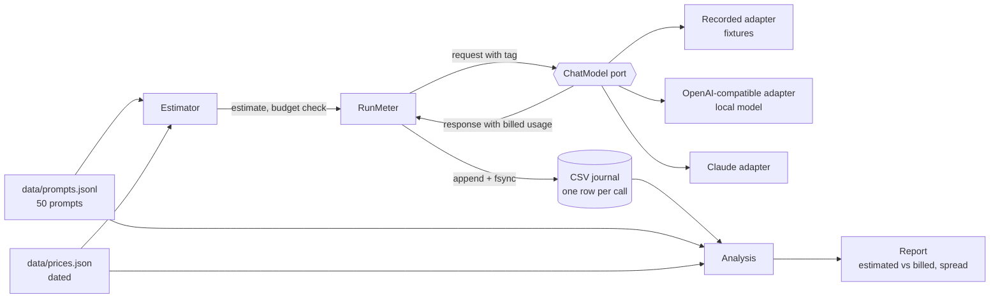

# Architecture: ai-token-and-cost-meter

`meter` estimates what a batch of model calls will cost, makes the calls, records what the provider billed, and reports how far the estimate was off and how much the answers vary. This document names the parts, follows one run through them, and says what a production version would add.

## Pattern

Ports and adapters (hexagonal), in four folders. The pattern fits because the system has exactly two boundaries that must be replaceable: the model (a recording in tests, a local server for the experiment, Claude for a real run) and the journal (a file today). Everything that is a decision about tokens, money or statistics sits in `domain` and is tested without either boundary.

## Components

| Component | Layer | Owns |
| --- | --- | --- |
| `domain.prompts` | domain | the five prompt kinds, the rules that make the 50 prompts a fair sample, one parser that names the field that is wrong |
| `domain.pricing` | domain | the dated price table and the refusal of a stale one |
| `domain.estimation` | domain | `TokenEstimator` (characters per token, per-call overhead, a ratio per kind), the run estimate and the budget check |
| `domain.analysis` | domain | estimated against billed by kind, the cause of the largest gap, calibration, the held-out cost check, spread per setting |
| `domain.llm`, `domain.errors` | domain | vendor-neutral request, response, usage and the named errors |
| `application.run_meter` | application | the run: estimate first, refuse above the budget, one call per missing key, one journal row per call, stop between calls on request |
| `application.report` | application | joins the journal to the prompts and the prices and builds the report |
| `application.metered_model` | application | a decorator a service can put around any model to log estimate and bill side by side |
| `application.ports` | application | `ChatModel`, `Embedder`, `Clock`, `Journal` |
| `infrastructure.recording` | infrastructure | replay and record of model answers as JSON Lines |
| `infrastructure.openai_compatible`, `anthropic_chat`, `resilient` | infrastructure | the local-server adapter, the Claude adapter and retry with backoff |
| `infrastructure.csv_journal` | infrastructure | the append-and-fsync journal and its torn-tail rule |
| `infrastructure.files`, `settings`, `model_factory`, `logging`, `shutdown` | infrastructure | file readers, validated environment configuration, wiring, logfmt logs, signal handling |
| `interfaces.cli`, `render` | interfaces | the `meter` command, its exit codes and the plain-text report |

The dependency rule is the usual one: `domain` imports nothing outside the standard library, `application` imports `domain`, `infrastructure` and `interfaces` import both, nothing imports `interfaces`. `import-linter` enforces it in `make lint`, and a second contract forbids `domain` and `application` from importing `anthropic`, `httpx` or `openai`.

## Data flow

Drawn versions of this figure and of the walk-through: [the architecture](docs/diagrams/architecture.svg) and [one run](docs/diagrams/flow.svg).

One run, in order:

1. `meter run` reads the settings from the environment and validates them. A bad value stops here with exit code 2 and the variable's name.
2. It loads the prompt file (a bad line is reported with its number) and checks the set against the lesson's rules: 50 prompts, the five kinds in the right counts, unique ids, one prompt over 1,500 tokens.
3. It loads the price file and refuses a table older than `PRICE_MAX_AGE_DAYS` (exit 3).
4. It opens the journal. A missing file gets a header; an existing file loses any half-written last line; a file with the wrong header is refused.
5. It estimates the calls the journal does not hold yet and prints the estimate. If a budget is set and the estimate is above it, it stops with `REFUSING TO START` (exit 3) before any call.
6. For each (prompt, setting, repeat) not in the journal it builds a request whose tag is `<prompt>/<setting>/<repeat>`, calls the model, appends one row with the billed input and output tokens, the stop reason and the latency, and fsyncs.
7. Between calls it checks the shutdown flag. `SIGTERM` or `SIGINT` lets the call in flight finish, then exits with code 4. `SIGKILL` leaves at most a half-written last line, which step 4 removes on the next start.
8. `meter report` reads the journal and the prompts and prints the comparison.

## Decisions and trade-offs

Each has a short record in [docs/adr](docs/adr).

- **The model is a port** ([0001](docs/adr/0001-the-model-is-a-port-with-three-adapters.md)). Recorded answers make the 450-call report identical on every machine and free to run; the cost is that fixtures go stale when a prompt changes, and the error says how to refresh them.
- **Claude gets no sampling parameters** ([0002](docs/adr/0002-claude-is-not-asked-for-sampling.md)). The current Messages API rejects `temperature` and `top_p`, so the three-setting experiment runs on the local model and the tool refuses to pretend otherwise.
- **Calibrate on half the prompts, check on the other half** ([0003](docs/adr/0003-estimate-calibrate-then-check-on-held-out-rows.md)). A check on the data it was fitted to proves nothing. The split alternates within each kind so every kind is on both sides.
- **A CSV journal with fsync** ([0004](docs/adr/0004-csv-journal-with-fsync-and-a-torn-tail-rule.md)). The restart key is the tuple `(prompt_id, setting, repeat)`; a crash costs at most one call and never a duplicate.
- **`Decimal` for money.** Prices are strings in the price file and `Decimal` everywhere, so a sum of 450 small costs is exact.
- **The pre-run estimate assumes the output cap.** The answer length is unknown before the call, so the honest upper bound is the cap; the report shows that ceiling next to the calibrated estimate.
- **Time and the sleep function are injected** (`Clock`, `sleep=`), so the stale-price rule and the throttle are tested without waiting.

## Failure modes the lesson teaches, and where the code shows them

| Failure | Where it shows |
| --- | --- |
| The estimate is far below the bill because the chat template adds tokens you never typed | `meter report`, stage 1 against stage 2; `domain.analysis.calibrate_overhead` |
| One global error hides which kind of prompt is wrong | the report lists the error per kind; `compare_estimates` groups by kind |
| Non-English and code tokenize less compactly than prose | the fitted ratios per kind; `explain_gap` names the cause of the largest gap |
| A crash pays for the same call twice | `RunMeter` skips journaled keys; `tests/integration/test_cli_process.py` kills the process with `SIGKILL` and restarts |
| A header written twice, or a header missing | `CsvJournal` writes it only on creation and raises `JournalCorrupt` on a wrong one |
| Stale prices | `PriceTable.require_fresh`, exit code 3 |
| A budget that is ignored | the budget check runs before the first call; a test asserts the model saw no request |
| "Billed" tokens recomputed locally | the journal stores `response.usage` from the adapter; no tokenizer is imported anywhere |
| Temperature 0 assumed to be deterministic | the report states whether it was, from the data (it was not exactly, on this local server) |

## Limits of the teaching build

- One process, one model, one journal file. A production meter would write to a database with a unique key on the restart tuple, and run calls concurrently under a rate limit.
- The recordings come from one small local model. The token counts, the overhead and the densities are that model's; a different model gives different numbers, which is the point of re-running `make record`.
- Prices are copied by hand into a file with a date. A production system would read them from the provider's price list or a billing export, and alert on a change.
- No prompt caching, batch pricing or reasoning-token accounting. The estimator would need those fields before it could be trusted on a model that bills them.

## How to extend it

- **Another model:** add an adapter that implements `ChatModel` (and set `supports_sampling` honestly), register it in `model_factory`, record with `RECORD=on`.
- **Another setting:** add a `DecodingSetting` to `DEFAULT_SETTINGS`; the journal, the estimate and the report pick it up.
- **Prompt caching (stretch):** add the cached-token fields to `Usage` and `JournalRow`, price them in `PriceTable.cost`, and report the cached share per setting.
- **Use the estimator in a service (stretch):** wrap the service's model in `MeteredChatModel`; it logs estimate and bill side by side with no prompt text.
