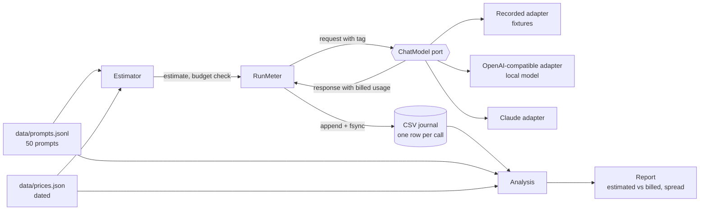

# Mermaid diagrams

## What it is

**Mermaid** is a way to draw diagrams by writing text. You put the description inside a code fence marked `mermaid`; a viewer that supports it (GitHub does) turns the text into a picture. A **flowchart** is a diagram of boxes (**nodes**) joined by arrows (**edges**), usually showing how data or control moves through a system.

## Why this repository uses it

`ARCHITECTURE.md` explains how the system is organized, and a picture of the parts and the arrows between them is the fastest way to see that. Because the picture is text, it lives in version control: a change to the design is a visible change in a diff, and nobody has to maintain a separate image file.

## Where it appears

| File | What it does with this technology |
| --- | --- |
| `ARCHITECTURE.md` | the diagram |

## How it works underneath

The viewer loads the Mermaid library, which parses the text into a graph (nodes and edges), computes a layout, and draws it as SVG. Node ids (`PG`, `CH`) are only names used to connect arrows; the visible text is the label in brackets. The shape of the brackets chooses the shape of the node: `[text]` a box, `[(text)]` a database cylinder, `{text}` a diamond (a decision), `{{text}}` a hexagon. `<br/>` inside a label starts a new line. An arrow can carry a label between pipes: `A -->|label| B`.

## Walkthrough of this repository's use

The diagram in `ARCHITECTURE.md`:



Line by line:

- `flowchart LR`: the diagram type is a **flowchart**; `LR` means it is laid out left to right.
- `P[data/prompts.jsonl<br/>50 prompts] --> E[Estimator]`: draws an arrow from `P` (a box labeled "data/prompts.jsonl / 50 prompts") to `E` (a box labeled "Estimator").
- `PR[data/prices.json<br/>dated] --> E`: draws an arrow from `PR` (a box labeled "data/prices.json / dated") to `E` (defined earlier: a box labeled "Estimator").
- `E -->|estimate, budget check| R[RunMeter]`: draws an arrow, with the label "estimate, budget check" from `E` (defined earlier: a box labeled "Estimator") to `R` (a box labeled "RunMeter").
- `R -->|request with tag| M{{ChatModel port}}`: draws an arrow, with the label "request with tag" from `R` (defined earlier: a box labeled "RunMeter") to `M` (a hexagon labeled "ChatModel port").
- `M --> REC[Recorded adapter<br/>fixtures]`: draws an arrow from `M` (defined earlier: a hexagon labeled "ChatModel port") to `REC` (a box labeled "Recorded adapter / fixtures").
- `M --> LOC[OpenAI-compatible adapter<br/>local model]`: draws an arrow from `M` (defined earlier: a hexagon labeled "ChatModel port") to `LOC` (a box labeled "OpenAI-compatible adapter / local model").
- `M --> CL[Claude adapter]`: draws an arrow from `M` (defined earlier: a hexagon labeled "ChatModel port") to `CL` (a box labeled "Claude adapter").
- `M -->|response with billed usage| R`: draws an arrow, with the label "response with billed usage" from `M` (defined earlier: a hexagon labeled "ChatModel port") to `R` (defined earlier: a box labeled "RunMeter").
- `R -->|append + fsync| J[(CSV journal<br/>one row per call)]`: draws an arrow, with the label "append + fsync" from `R` (defined earlier: a box labeled "RunMeter") to `J` (a database cylinder labeled "CSV journal / one row per call").
- `J --> A[Analysis]`: draws an arrow from `J` (defined earlier: a database cylinder labeled "CSV journal / one row per call") to `A` (a box labeled "Analysis").
- `P --> A`: draws an arrow from `P` (defined earlier: a box labeled "data/prompts.jsonl / 50 prompts") to `A` (defined earlier: a box labeled "Analysis").
- `PR --> A`: draws an arrow from `PR` (defined earlier: a box labeled "data/prices.json / dated") to `A` (defined earlier: a box labeled "Analysis").
- `A --> REP[Report<br/>estimated vs billed, spread]`: draws an arrow from `A` (defined earlier: a box labeled "Analysis") to `REP` (a box labeled "Report / estimated vs billed, spread").

## Try it yourself

1. Find the fence that starts the diagram.

```bash
grep -n 'mermaid' ARCHITECTURE.md
```

What you should see (captured from this repository):

```text
32:```mermaid
```

2. How many lines of Mermaid text the diagram has.

```bash
awk '/```mermaid/{f=1;next} /```/{f=0} f' ARCHITECTURE.md | wc -l | tr -d ' '
```

What you should see (captured from this repository):

```text
14
```

3. How many arrows (solid, with or without a label) it draws.

```bash
awk '/```mermaid/{f=1;next} /```/{f=0} f' ARCHITECTURE.md | grep -c -- '-->'
```

What you should see (captured from this repository):

```text
13
```

## Mistakes people make

- **Reusing a node id for two things.** The second definition would replace the first. Ids are unique.
- **A label with brackets or quotes.** They can end the node early; labels here avoid them.
- **Expecting every viewer to draw it.** Some editors show the text. The surrounding paragraphs say the same thing in words.
- **Forgetting `end` after `subgraph`.** The group would swallow the rest of the diagram.

## Check yourself

1. What does `A -->|yes| B` draw?

   *Answer:* An arrow from A to B labeled "yes".

2. Which brackets draw a database cylinder?

   *Answer:* `[( ... )]`.

3. What does `flowchart LR` set?

   *Answer:* A flowchart laid out left to right.

4. What is a node id for?

   *Answer:* To connect edges; the visible text is the label.

5. What does `-.->` draw?

   *Answer:* A dotted arrow.

## Further reading

- Mermaid documentation, https://mermaid.js.org/syntax/flowchart.html (the diagrams could not be rendered in this session; the explanation was generated from the diagram text by a parser that stops on any syntax it does not know).
